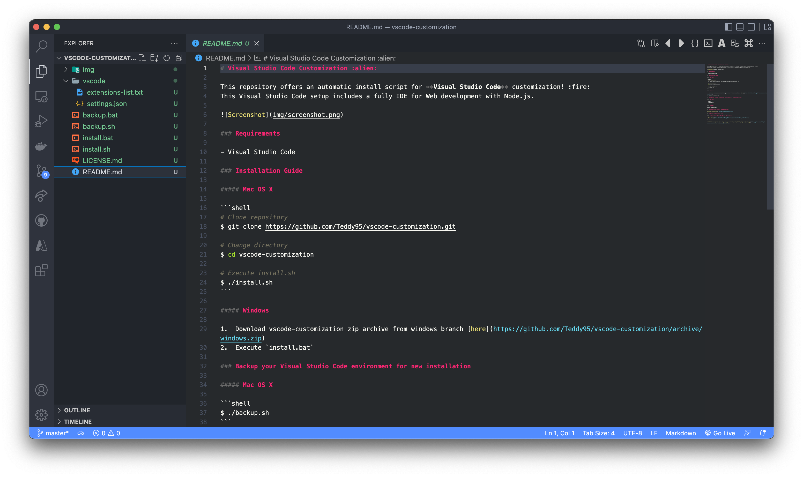

# Visual Studio Code Customization :alien:

This repository offers an automatic install script for **Visual Studio Code** customization! :fire:  
This Visual Studio Code setup includes a fully IDE for Web development with Node.js.



### Requirements

- Visual Studio Code
- SQLite3 command line tool (for Activity Bar backup/restore)

#### Installing SQLite3

##### Windows

```shell
winget install SQLite.SQLite
```

##### Mac OS X

SQLite3 is pre-installed on macOS. If needed, you can update it via Homebrew:

```shell
brew install sqlite3
```

##### Linux

```shell
# Debian/Ubuntu
sudo apt-get install sqlite3

# Fedora/RHEL
sudo dnf install sqlite

# Arch Linux
sudo pacman -S sqlite
```

### Installation Guide

##### Mac OS X

```shell
# Clone repository
$ git clone https://github.com/Teddy95/vscode-customization.git

# Change directory
$ cd vscode-customization

# Execute install.sh
$ ./install.sh
```

##### Windows

1.  Download vscode-customization zip archive from windows branch [here](https://github.com/Teddy95/vscode-customization/archive/windows.zip)
2.  Execute `install.bat`

### Backup your Visual Studio Code environment for new installation

##### Mac OS X

```shell
$ ./backup.sh
```

##### Windows

Execute `backup.bat`

### Included Visual Studio Code extensions

[Included extensions](./vscode/extensions-list.txt)

### Included configuration files

##### Configuration files for Visual Studio Code

⇒ [Show files](https://github.com/Teddy95/vscode-customization/tree/master/vscode)

**Backed up files:**
- `settings.json` - VS Code settings and preferences
- `extensions-list.txt` - List of installed extensions
- `activity-bar.json` - Activity Bar configuration (visible/hidden items and order)

**Note:** The Activity Bar configuration is extracted from VS Code's SQLite database (`state.vscdb`) using the `workbench.activity.pinnedViewlets2` key. This ensures only the Activity Bar settings are backed up, avoiding machine-specific data.

### License

[](https://github.com/Teddy95/vscode-customization/blob/master/LICENSE.md)
